<div align="center">

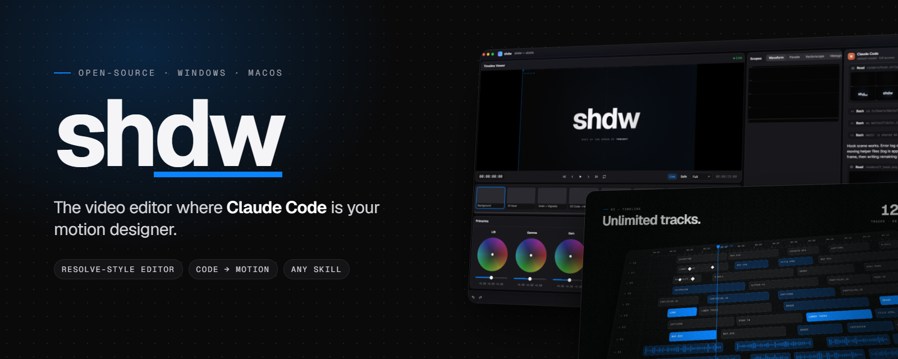

# shdw

### The open-source video editor where **Claude Code** (or Codex) is your motion designer.

A DaVinci Resolve-style editor — timeline, color, audio, deliver — with an AI agent built in that **writes motion graphics as code**, cuts your footage, grades, captions, and *checks its own work frame by frame* before you ever press play.

[](https://github.com/d4niel-fr/shdw-video-editor/releases/latest)
[](https://github.com/d4niel-fr/shdw-video-editor/releases/latest)

[](https://github.com/d4niel-fr/shdw-video-editor/releases)
[](#-license--credit)
[](https://github.com/d4niel-fr/shdw-video-editor/stargazers)

**[Quick start](#-quick-start)** · **[What it makes](#-made-with-shdw)** · **[Why not just prompt an animation?](#-why-shdw-instead-of-one-shot-ai-animation)** · **[Skills](#-use-any-claude-code-skill--design-skills-included)** · **[Controls](#-getting-around-controls--shortcuts)** · **[How it works](#-how-it-works)**

</div>

<br>

<p align="center">
  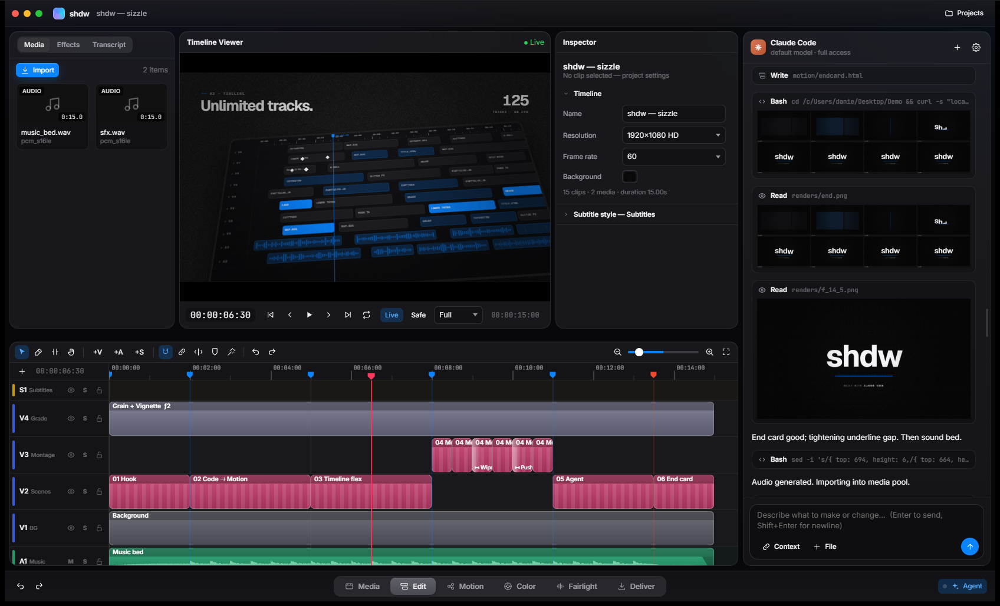
</p>
<p align="center"><sub><b>Edit page.</b> The agent (right) built this whole 15-second sizzle — six HTML/GSAP scenes, transitions, a grain + vignette grade, music and SFX — then rendered contact sheets to verify it.</sub></p>

---

## ✨ Type one sentence. Get a finished, editable video.

```text
"Make a 15-second Apple-keynote-style sizzle for my app. Dark, one blue accent,
 kinetic type, a code-to-motion split screen, a 3D timeline, end card. Verify every scene."
```

The agent writes each scene as a real motion-graphics file in your project, drops them on the timeline, adds transitions, grade and sound, **renders frames to look at its own output**, fixes what's off, and exports — while you watch it happen live in the viewer. Everything it makes stays editable: drag clips, tweak keyframes, change a color, or just say *"make the intro punchier."*

<p align="center">
  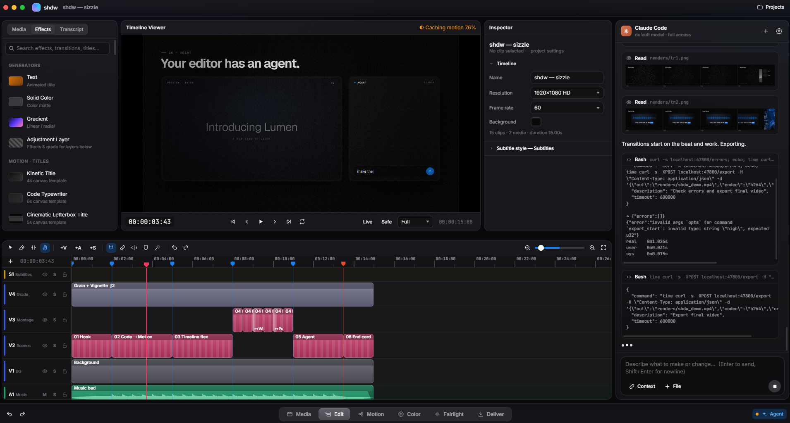
</p>

---

## 🎬 Made with shdw

Every frame below was generated **inside shdw by the agent** — no After Effects, no stock templates. Each scene is a code file you can open, read, and edit.

<p align="center">
  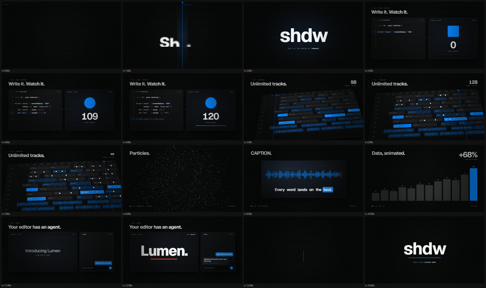
</p>
<p align="center"><sub><b>"shdw — sizzle"</b>: 15 s, 1920×1080 @ 60 fps. Hook → code-to-motion → 3D timeline → montage → agent → end card.</sub></p>

<table>
<tr>
<td width="33%">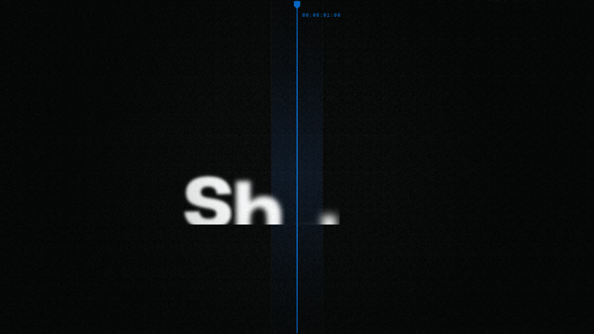</td>
<td width="33%">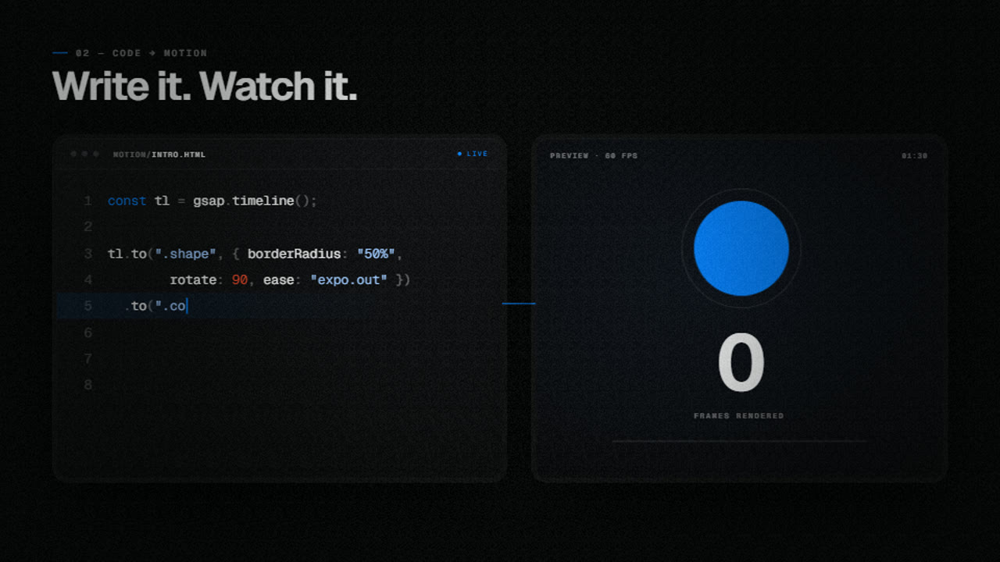</td>
<td width="33%">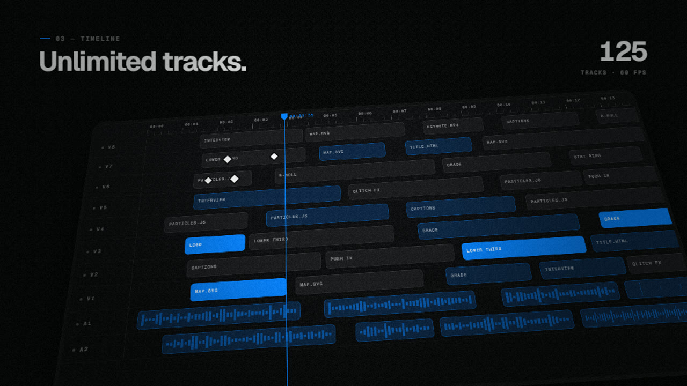</td>
</tr>
<tr>
<td>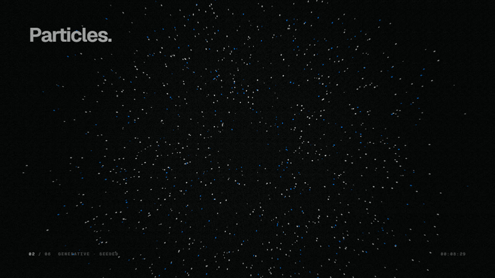</td>
<td>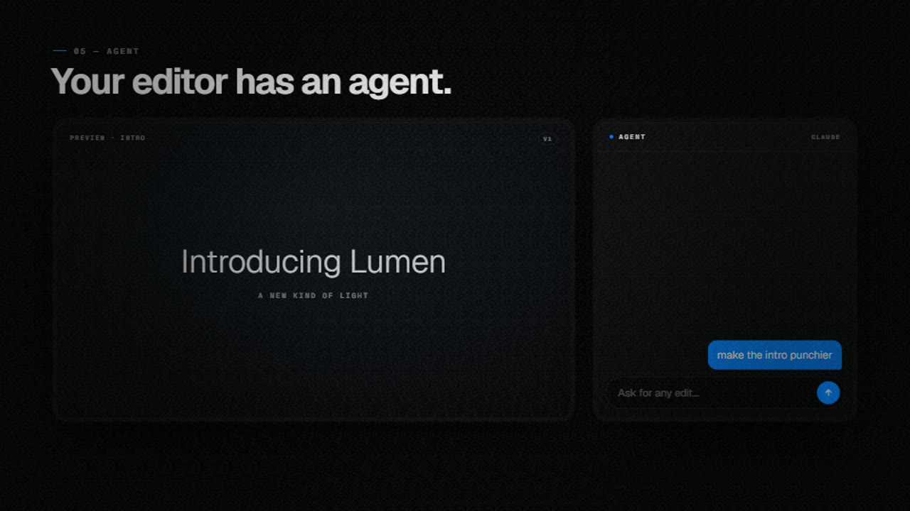</td>
<td>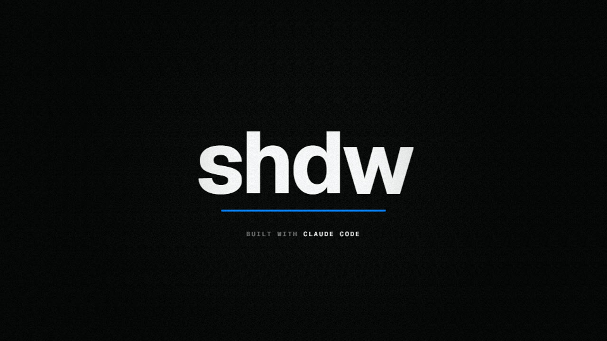</td>
</tr>
</table>

**Completely different style, same tool:** a 7-minute documentary with 119 clips — chapter cards, verse callouts, timelines, citations, artwork plates — all generated and laid out by the agent.

<table>
<tr>
<td width="40%">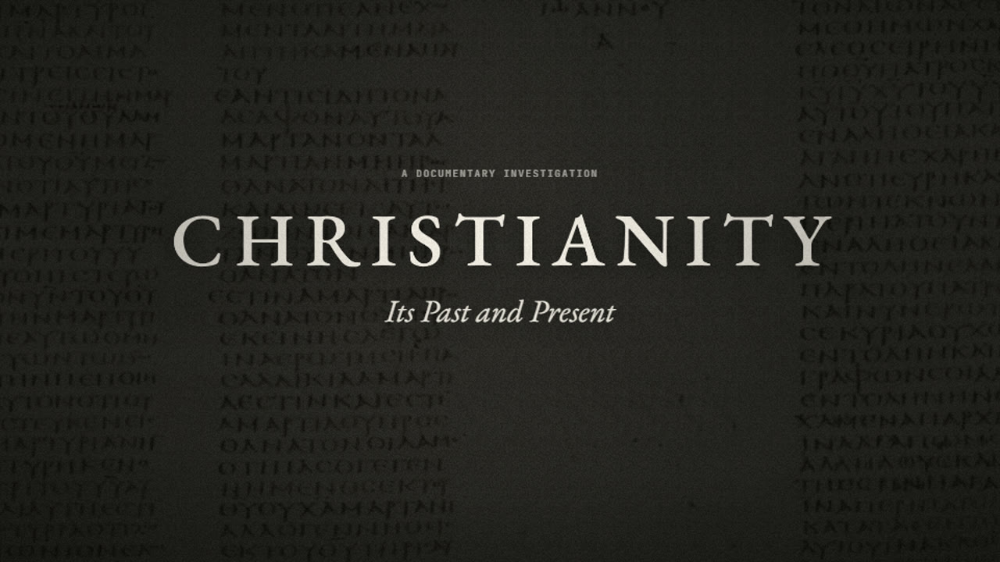</td>
<td width="60%">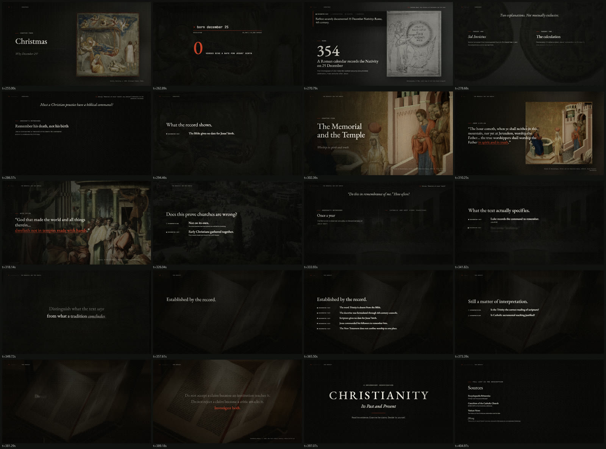</td>
</tr>
</table>

---

## 🥊 Why shdw instead of one-shot AI animation?

Prompt-to-animation tools (Claude Design–style canvases, "text to motion" generators) are great for **one clip**. A real video needs much more than one clip. shdw puts the agent **inside a full editor**:

| | One-shot AI animation | **shdw** |
| --- | :---: | :---: |
| Generates motion graphics from a prompt | ✅ | ✅ |
| **Multi-scene timeline** with unlimited video / audio / subtitle tracks | ❌ | ✅ |
| Mix generated graphics with **your real footage**, audio and voice-over | ❌ | ✅ |
| Transitions, blend modes, 37 GPU effects, adjustment layers | ❌ | ✅ |
| Color page — wheels, LUTs, scopes | ❌ | ✅ |
| Audio — mixer, music bed, SFX, loudness normalize, silence removal | ❌ | ✅ |
| Whisper **auto-captions**, transcript editing | ❌ | ✅ |
| **Agent verifies its own output** (renders frames & contact sheets, reads errors, fixes) | ❌ | ✅ |
| Edit everything by hand afterwards — keyframes on every property | rarely | ✅ |
| Export **MP4 / H.265 / ProRes 4444 with alpha / WebM alpha / GIF / SRT** | limited | ✅ |
| Frame-exact, deterministic renders (same input → same pixels) | ❌ | ✅ |
| Your files, on your disk, in plain text (HTML / JS / JSON) — no lock-in | ❌ | ✅ |
| Use **any Claude Code skill** (design, motion, brand…) | ❌ | ✅ |
| Works with **Claude Code _and_ Codex** | ❌ | ✅ |
| Free & open source | ❌ | ✅ |

**The short version:** other tools hand you an animation. shdw hands you an **edit** — and an editor to keep going.

---

## 🧠 Use any Claude Code skill — design skills included

shdw runs the real `claude` CLI in your project folder, so **every skill you've installed in Claude Code works automatically** — no plugins, no config. Ask for a style and the agent pulls the right skill:

<p align="center">
  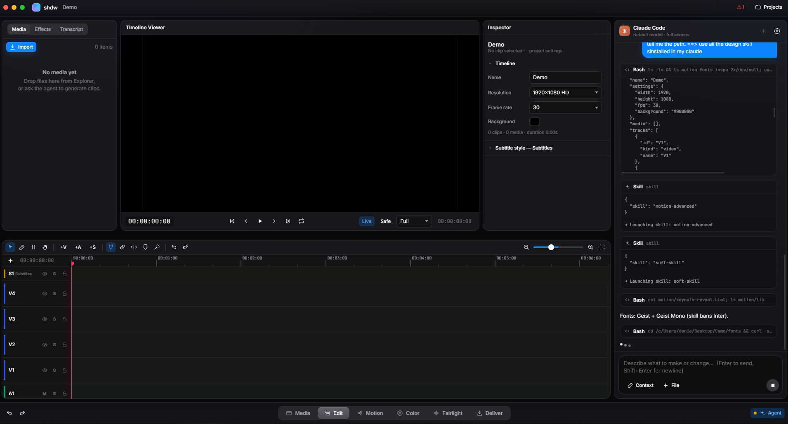
</p>
<p align="center"><sub>The agent loading two installed design skills (<code>motion-advanced</code>, <code>soft-skill</code>) before writing any scene. The skill picked the fonts (Geist / Geist Mono) and the "double-bezel card" look you see in the sizzle above.</sub></p>

Things that work great:

- **Design / taste skills** → typography, spacing, palettes, "no AI-slop" rules applied to every scene.
- **Motion skills** → easing curves, choreography, kinetic type patterns.
- **Brand skills** → drop your brand guide in a skill and every video comes out on-brand.
- **Your own skills** → anything in `~/.claude/skills/` (or a project's `.claude/skills/`) is available.

> 💡 Tip: put reference images in the project's **Inspiration** board (`inspo/`, Media page → *Add inspiration*). The agent looks at them before designing.

Prefer **Codex**? Switch provider in the agent panel ⚙ — same workflow, same project files.

---

## 🚀 Quick start

### 1. Download

Grab the latest build from **[Releases](https://github.com/d4niel-fr/shdw-video-editor/releases/latest)**:

| Platform | File |
| --- | --- |
| **Windows 10 / 11** | `shdw_x.y.z_x64-setup.exe` (or `.msi`) |
| **macOS 11+** (Apple Silicon & Intel) | `shdw_x.y.z_universal.dmg` |

> **macOS:** builds aren't notarized yet. After dragging shdw to Applications run once: `xattr -cr /Applications/shdw.app`

### 2. Install the three things shdw drives

| | Windows | macOS |
| --- | --- | --- |
| **FFmpeg** (decode / encode / captions) | `winget install Gyan.FFmpeg` | `brew install ffmpeg` |
| **Chromium browser** (renders HTML motion) | Edge — already installed | Chrome, Edge, Brave or Chromium |
| **Agent CLI** — one or both | `npm i -g @anthropic-ai/claude-code` · `npm i -g @openai/codex` | same |

Log in once in a terminal (`claude` / `codex`). shdw's start screen shows a green dot when each one is found.

### 3. Make something

1. **New project** → pick a folder.
2. Press **Ctrl/⌘ + K** and describe your video.
3. Watch the timeline fill up. Scrub, tweak, re-prompt.
4. **Deliver** page (Shift + 6) → **Render**.

<p align="center">
  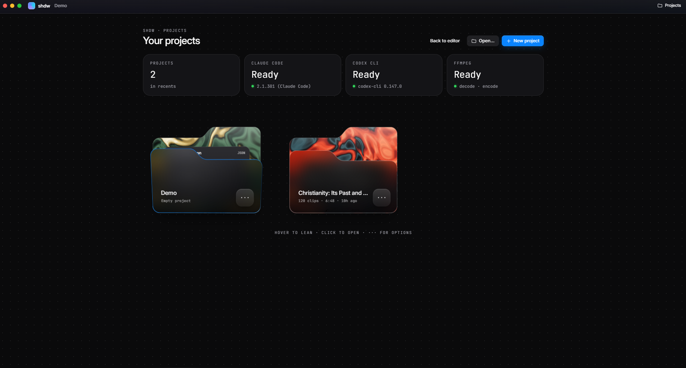
</p>
<p align="center"><sub>Projects screen (Ctrl/⌘ + O). Each project is a glass folder showing its latest renders. <b>···</b> → Open · Show in Explorer · Remove from list · Delete project.</sub></p>

---

## 🧭 Getting around (controls & shortcuts)

shdw is laid out like DaVinci Resolve: **six pages** along the bottom bar, the **agent panel** on the right of every page.

### Moving around the timeline

| Do this | How |
| --- | --- |
| **Zoom timeline** in / out | **Ctrl/⌘ + mouse wheel** (zooms around the cursor) · or **`+`** / **`-`** |
| **Fit whole edit** to the window | **Shift + Z** · or the ⤢ button top-right of the timeline |
| **Scroll timeline** left / right | **Shift + wheel** · or trackpad sideways swipe |
| Scroll tracks up / down | mouse wheel |
| Zoom slider | the slider beside the 🔍 icons above the timeline |
| Scrub | drag in the ruler, or click anywhere on it |
| Step one frame | **← / →** (hold **Shift** for 1 second) |
| Jump to previous / next cut | **↑ / ↓** |
| Start / end | **Home / End** |
| Scrub frame-by-frame in the viewer | **Alt + wheel** over the viewer |

### Playback & editing

| Key | Action | Key | Action |
| --- | --- | --- | --- |
| **Space** | Play / pause | **J / K / L** | Shuttle back / stop / forward |
| **I / O** | Mark in / out | **Alt + X** | Clear in / out |
| **A** | Select tool | **B** | Blade tool |
| **T** | Trim tool | **H** | Hand tool |
| **Ctrl + B** | Split at playhead | **Del / Shift + Del** | Delete / ripple delete |
| **Ctrl + C / X / V / D** | Copy / cut / paste / duplicate | **Ctrl + L** | Link / unlink A+V |
| **Ctrl + T** | Add transition at playhead | **, / .** | Nudge clip one frame |
| **M** | Add marker | **N** | Toggle snapping |
| **D** | Enable / disable clip | **Ctrl + A** | Select all |
| **Ctrl + Z / Y** | Undo / redo | **Ctrl + S** | Save |

### App

| Key | Action |
| --- | --- |
| **Ctrl/⌘ + K** | Open the agent and focus the prompt |
| **Ctrl/⌘ + O** | Projects screen |
| **Ctrl/⌘ + I** | Import media |
| **Ctrl/⌘ + E** | Deliver page |
| **Shift + 1 … 6** | Media · Edit · Motion · Color · Fairlight · Deliver |

### In the viewer

- **Drag** a selected clip to move it · **Shift + drag** to scale · **Alt + drag** to rotate.
- **Live** — compositions play as real, sharp web pages in real time. Turn off to see the exact rendered frames export will produce.
- **Safe** — title/action safe guides. **Full / Half / Quarter** — preview resolution.

---

## 🧩 The pages

<table>
<tr>
<td width="50%">
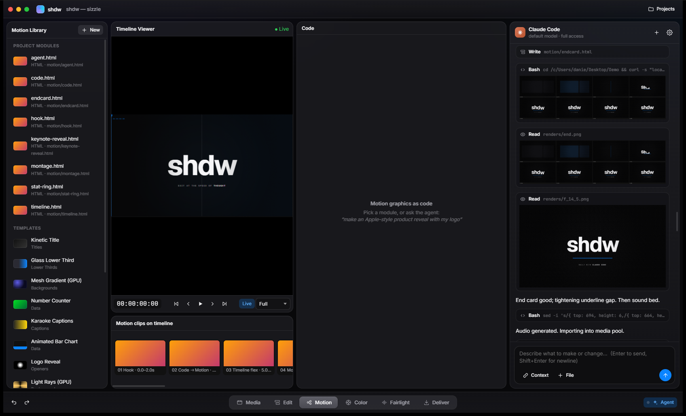
<b>Motion</b> — the Fusion equivalent. Every motion graphic is a file: HTML/CSS/SVG + GSAP, canvas JS, or GLSL. Live preview, code editor, 17 templates (kinetic titles, lower thirds, mesh gradients, light rays, karaoke captions, bar charts, logo reveals…).
</td>
<td width="50%">
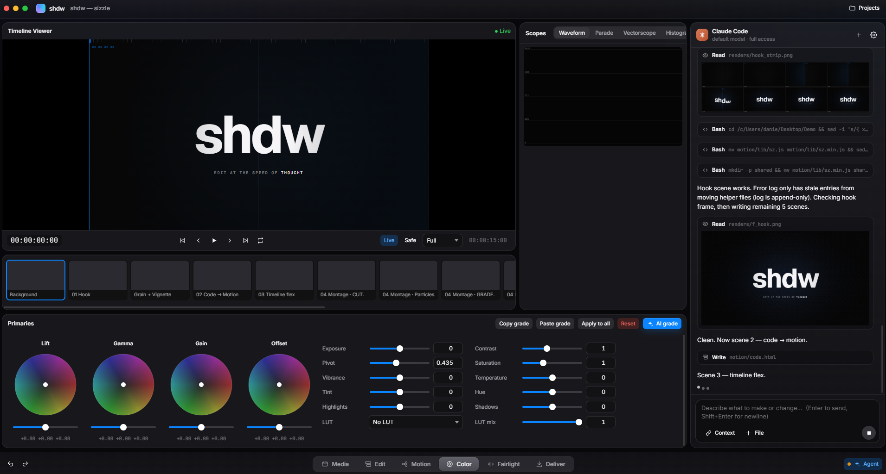
<b>Color</b> — lift / gamma / gain / offset wheels, primaries, <code>.cube</code> LUTs, waveform · parade · vectorscope · histogram, copy / paste / apply-all grade, and <b>AI grade</b>.
</td>
</tr>
<tr>
<td>
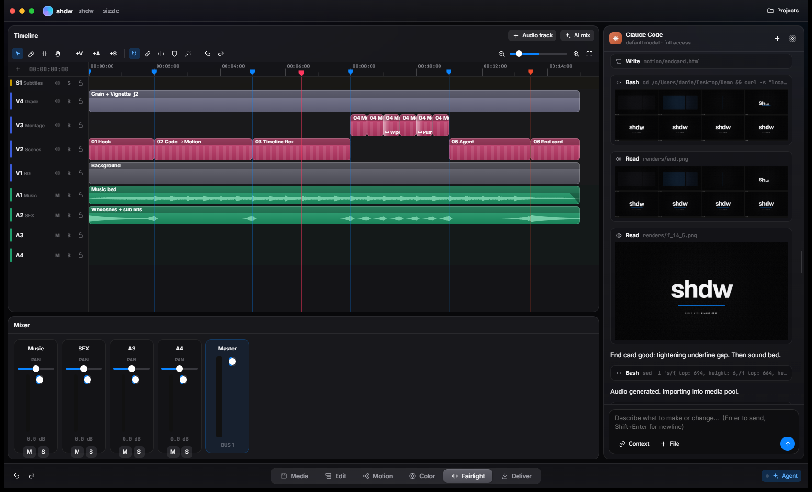
<b>Fairlight</b> — mixer with faders, pan, mute / solo, meters and master bus. Loudness normalize, silence removal, beat detection, voice enhance, denoise. <b>AI mix</b>.
</td>
<td>
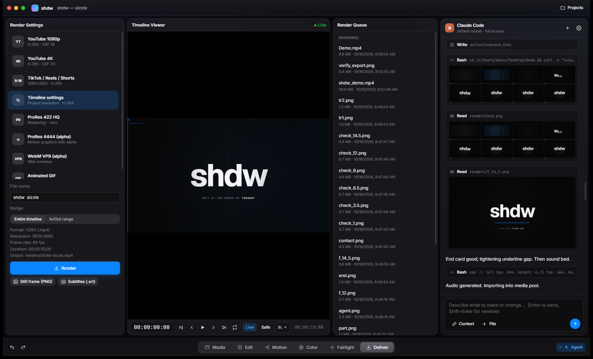
<b>Deliver</b> — presets for YouTube 1080p / 4K, TikTok / Reels / Shorts, ProRes 422 HQ, <b>ProRes 4444 & WebM with alpha</b>, GIF, still frames and SRT subtitles.
</td>
</tr>
<tr>
<td>
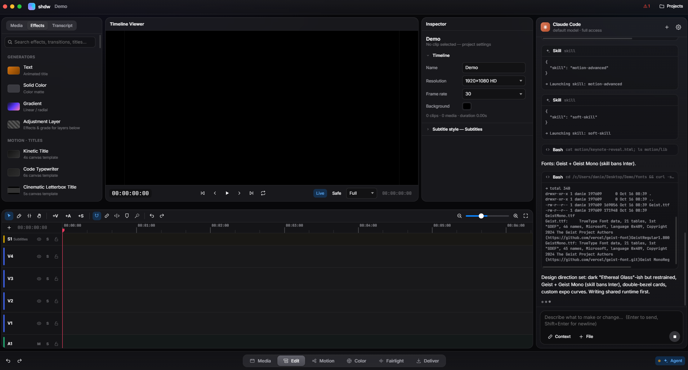
<b>Effects library</b> — generators, adjustment layers, motion titles, 36 transitions, 37 GPU effects, 22 blend modes. Drag onto the timeline.
</td>
<td>
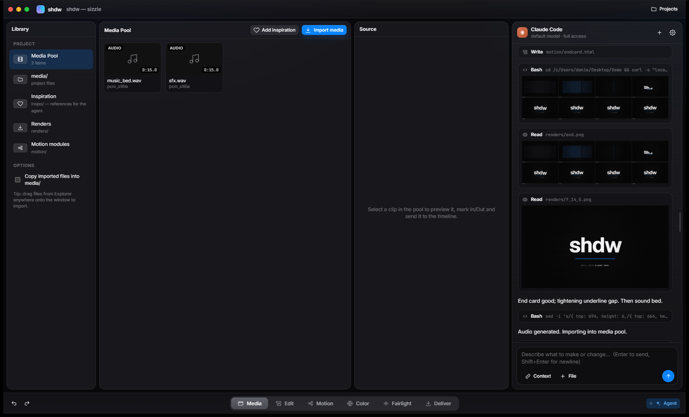
<b>Media</b> — media pool, project folders, source viewer with in / out, and the <b>Inspiration</b> board the agent reads before it designs.
</td>
</tr>
</table>

### Everything built in

**Editing:** unlimited V / A / subtitle tracks · select / blade / ripple-trim / hand · snapping · linked A/V · markers · in/out · keyframes on every property · transcript-based editing · undo/redo
**Look:** 22 blend modes · 37 GPU effects (blurs, glow, chroma/luma key, film grain, VHS, glitch, lens distortion, letterbox…) · 36 transitions · adjustment layers · LUTs
**Smart tools:** Whisper captions (offline) · scene-cut detection · silence removal · loudness normalize · beat markers · stabilize · denoise · voice enhance · reverse · optical-flow slow-mo · freeze frame · proxies
**Export:** H.264 · H.265 · ProRes 422 HQ · ProRes 4444 (alpha) · VP9 (alpha) · GIF · PNG stills · SRT

---

## ⚙️ How it works

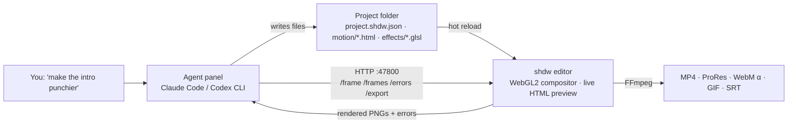

- **Rust (Tauri 2)** backend: FFmpeg decode/encode, file watching, a pool of headless Chromium renderers with *virtualized time* (frame-exact, deterministic HTML motion with alpha).
- **WebGL2** GPU compositor for layers, effects, blend modes and transitions.
- **Live HTML preview** — compositions run as real DOM in the viewer: razor-sharp at any size, real time.
- Every project gets a `CLAUDE.md` / `AGENTS.md` describing the project format and the **local control API**, so the agent can render frames, contact sheets, import, transcribe, caption, process clips and export from the running editor — and *look at the result*.

<details>
<summary><b>Control API (for agents & scripts)</b></summary>

Local only, `http://127.0.0.1:47800`:

| Endpoint | What |
| --- | --- |
| `GET /state` · `GET /errors` | Project, playhead, selection, render-cache status, recent errors |
| `GET /frame?t=3.5` | Render one exact frame to `renders/` |
| `GET /frames?from=0&to=15&count=12` | Contact sheet |
| `GET /seek?t=` · `/play` · `/pause` · `/page?name=` | Drive the UI |
| `POST /import` · `/transcribe` · `/captions` · `/process?op=` | Media pipeline |
| `POST /export` `{out, codec, quality, from, to}` | Render the timeline |

</details>

---

## 💡 Prompt ideas

- *"Turn `media/interview.mp4` into a 60-second vertical short with burned-in karaoke captions and punch-in zooms on key words."*
- *"Make a product launch video for my app from these screenshots in `inspo/`. Apple keynote vibe."*
- *"Lower thirds for every speaker in the transcript, in our brand font."*
- *"Data-driven explainer: animate this CSV as a racing bar chart, 20 seconds, with a music bed."*
- *"Cut the silences, normalize to -14 LUFS, grade it warm, and export for YouTube."*

---

## 🛠 Build from source

```bash
git clone https://github.com/d4niel-fr/shdw-video-editor
cd shdw-video-editor
npm install
npx tauri dev                 # run in dev mode
npx tauri build               # release build + installer (nsis/msi on Windows, app/dmg on macOS)
```

Needs Node 20+, Rust stable, and the [Tauri prerequisites](https://tauri.app/start/prerequisites/). Releases are built for Windows and macOS (universal) by [GitHub Actions](.github/workflows/release.yml) on every `v*` tag.

---

## 🗺 Roadmap

- [ ] Notarized macOS builds · Linux AppImage
- [ ] Bundled FFmpeg (zero-setup install)
- [ ] Multi-cam and nested timelines
- [ ] Shareable motion-template packs
- [ ] More agent providers

Ideas and PRs welcome — open an [issue](https://github.com/d4niel-fr/shdw-video-editor/issues).

---

## 📜 License & credit

shdw is **free and open source** under the **[GNU AGPL-3.0](LICENSE)** with **additional attribution terms** ([NOTICE](NOTICE)):

- ✅ Use it, study it, modify it, share it — personally or commercially.
- ✅ Forks and derivatives are welcome, **as long as they stay open source under the same license.**
- 📌 Any fork or redistribution **must keep visible credit**: *"Based on shdw by d4niel-fr — https://github.com/d4niel-fr/shdw-video-editor"* in its README and in the app's About/credits screen.
- 🚫 You may not republish it as your own product, remove the credit, or use the **shdw** name/logo for a different product.

Videos you **make** with shdw are 100% yours — the license covers the editor, not your output.

---

<div align="center">

**If shdw saved you an afternoon in After Effects, give it a ⭐ — it really helps more people find it.**

[](https://star-history.com/#d4niel-fr/shdw-video-editor&Date)

Made by [d4niel-fr](https://github.com/d4niel-fr) · Built with Claude Code

</div>
